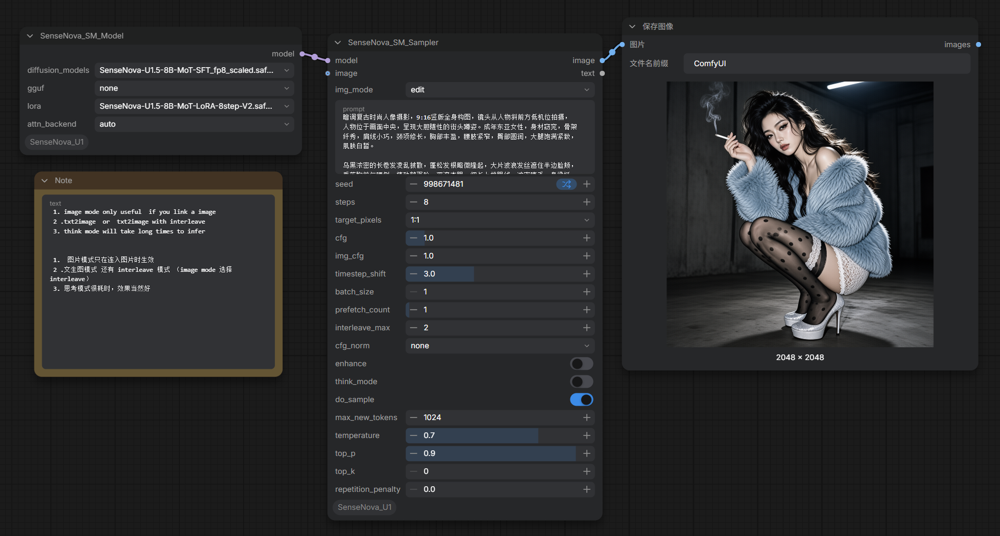

# ComfyUI_SenseNova_U1
[SenseNova-U1](https://github.com/OpenSenseNova/SenseNova-U1): Unifying Multimodal Understanding and Generation with NEO-Unify Architecture

# Update
* 适配高版本transformer，精简代码 / fitting to transformer 5.4.0，simplify code
* Add U1.5 support 新增U1.5支持(GGUF/INT8/FP8)，模型缓慢上传hf，获取去我的云盘拉取
* 新增fp8和convrot int8模型支持(Infographic-V3)，support fp8 and convrot int8 models
* 暂时以同步卸载模式适配moe模型,moe模式12G显存， 文生图时，count设置为8-9，图生图设置为4左右..
* support SenseNova-U1-A3B-MoT-SFT and SenseNova-U1-A3B-MoT and SenseNova-U1-A3B-MoT-SFT-gguf ,支持A3B MOE的单体合并模型和gguf模型,快速测试可以修改节点加载repo的分割模型.
* If Vram >16G make prefetch_count =0, 显存大于16G时，设置swap（prefetch_count）数值为0以关闭层交换（使用Q6 gguf时）


1.Installation  
-----
  In the ./ComfyUI/custom_nodes directory, run the following:   
```int
git clone https://github.com/smthemex/ComfyUI_SenseNova_U1
```
2.requirements  
----
```
pip install -r requirements.txt
```

3.checkpoints 
----
[U1.5-8B-links (preview and official )](https://huggingface.co/smthem/SenseNova-U1-8B-MoT-Merger-gguf)  
[A3B-links-modelscope](https://www.modelscope.cn/models/smthem/SenseNova-U1-A3B-MoT-SFT)   
[8B-links](https://huggingface.co/smthem/SenseNova-U1-8B-MoT-Merger-gguf)  
[A3B-links](https://huggingface.co/smthem/SenseNova-U1-A3B-MoT-SFT-gguf) 
[lora](https://huggingface.co/sensenova/SenseNova-U1-8B-MoT-LoRAs)  
[夸克网盘](https://pan.quark.cn/s/8180628d73c5)  
    
```
├── ComfyUI/models/gguf/ # GGUF模型可选
|     ├── SenseNova-U1.5-8B-MoT-SFT-Q8_0.gguf # optional 可选U1模型 SenseNova-U1-8B-MoT-8step-Q6_K.gguf or  SenseNova-U1-A3B-MoT-SFT-Q4_K_S.gguf
├── ComfyUI/models/diffusion_models/
|     ├── SenseNova-U1.5-8B-MoT-SFT_fp8_scaled.safetensors # 可选U1模型
├── ComfyUI/models/loras/
|     ├── SenseNova-U1.5-8B-MoT-LoRA-8step-V2.safetensors # optional 可选U1模型  SenseNova-U1-8B-MoT-LoRA-8step-V1.0.safetensors 

```

4. Example
----



5 .Citation
-----
```
@misc{sensenova2026neounify,
  title        = {NEO-unify: Building Native Multimodal Unified Models End to End},
  author       = {SenseNova},
  journal      = {Hugging Face blog},
  url          = {https://huggingface.co/blog/sensenova/neo-unify},
  year         = {2026}
}

@article{sensenova2026sensenovau1,
  title        = {SenseNova-U1: Unifying Multimodal Understanding and Generation with NEO-unify Architecture},
  author       = {Diao, Haiwen and Wu, Penghao and Deng, Hanming and Wang, Jiahao and Bai, Shihao and Wu, Silei and Fan, Weichen and Ye, Wenjie and Tong, Wenwen and Fan, Xiangyu and others},
  journal      = {arXiv preprint arXiv:2605.12500},
  year         = {2026}
}
```
